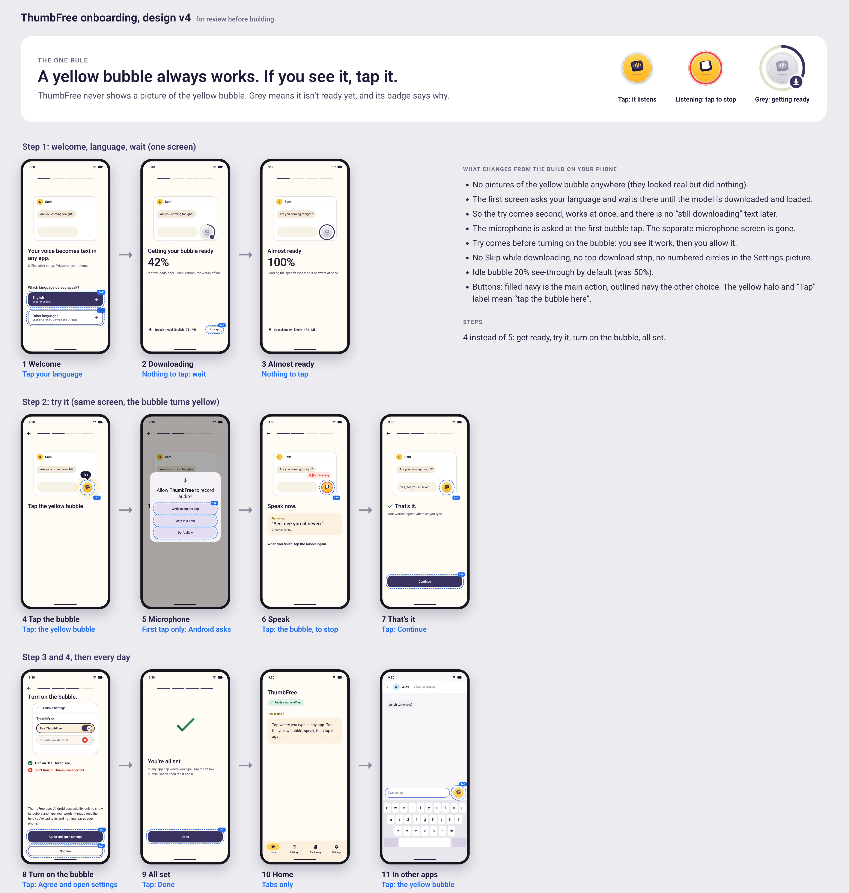

# Design boards

The boards the shipped screens were built from. `00-overview` shows a whole flow on one page; the other boards show one
screen each, with what can be tapped (a dashed blue outline marked TAP) and what comes next. All content on them is made
up.

| Folder | What it shows | Shipped in |
|---|---|---|
| [`android-onboarding-v4/`](android-onboarding-v4/) | The Android welcome: language and wait, the try, turning on the bubble, all set; then Home, the bubble in other apps, what happens when something stops, and what to say on the try | Android 1.0 (2) and later |
| [`ios-onboarding-v4/`](ios-onboarding-v4/) | The iPhone welcome's first step: the language choice, the download and what can stop it. The later screens (adding the keyboard, the try, Home) changed in 1.0.2, and their boards were removed | iPhone 1.0.1 and later |

The rule behind each design:

- **Android:** a yellow bubble always works. If you see it, tap it. When it can't work yet it is grey, and its badge
  says why (download, Wi-Fi or microphone). The app never shows a picture of the yellow bubble.
- **iPhone:** words teach the steps; the only real text box is the try. Steps and pictures sit in a soft frame with a
  small label (IN SETTINGS, IN ANY APP, EXAMPLE) and take no taps; a yellow ring with a Tap pill shows where to tap in
  the video over Settings. No drawing of a control sits where it could be taken for the real one: App Review held the
  try's drawn globe, so the try names the key, page 2 and Home list their steps, the session screen draws no stop key.

When a screen changes, replace its boards in the same change, or delete them, so the boards always match the app.

